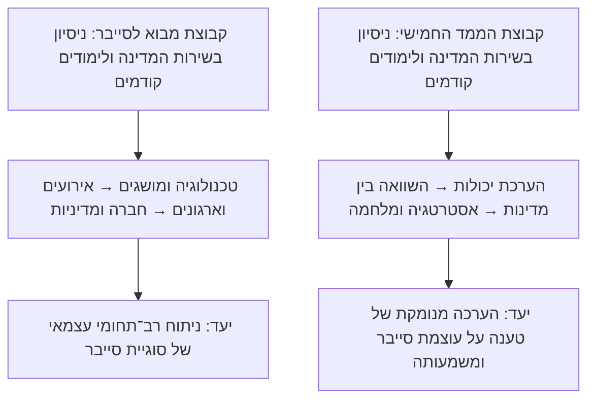

# שני קורסים לקבוצות שונות — היגיון משותף ומפות מסע נפרדות

הקורסים מיועדים לקבוצות שונות בשנים שונות, לפי הבהרת המרצה. אין להניח רצף לימודי בין הקבוצות או השתתפות של אותם סטודנטים בשני הקורסים. הניתוח מבוסס על שני הסילבוסים שסופקו, הנושאים את התאריך 4 באוגוסט 2026; תאריך המסמכים אינו קובע שהקורסים נלמדים בידי אותה קבוצה. המספור ותכני התחנות נשענים על הסילבוסים; שמות התחנות, שאלות המסע והחיבורים ביניהן הם הצעה פדגוגית. המסמך אינו משנה את סדר השיעורים, את דרישות הקורס או את משקלי ההערכה, ואינו מסכם את חומרי החובה.

## הסינתזה למרצה — לא מסלול משותף לסטודנטים

**השאלה האקדמית המשותפת בתכנון ההוראה: איך אפשר להבין ולהעריך את הקשרים בין טכנולוגיה, החלטות ועוצמה, על בסיס מושגים וראיות?**

״מבוא לסייבר״ בונה הבנה רחבה של המרחב הדיגיטלי ושל הקשרים בין טכנולוגיה, ארגונים, חברה ומדינה. ״סייבר — הממד החמישי״ מתמקד במדינה כשחקן, ובהערכת יכולות, אסטרטגיה ומלחמה. בשניהם מקרה ממשי הוא הזדמנות להשתמש במסגרת ניתוח, לבחון טענה ולהגדיר את גבולותיה.

לעובדים בשירות המדינה יש היכרות יומיומית עם מוסדות, שירותים, סמכויות ותהליכי עבודה. אין מכך שכל המשתתפים חולקים אותו ידע טכנולוגי או ביטחוני. ההוראה יכולה להשתמש בניסיון הזה כדי להצמיח שאלות, ולצרף אליו את הכלים המושגיים ואת הראיות שנדרשים לדיון אקדמי.

### מה מבדיל בין הקורסים

| היבט | מבוא לסייבר | סייבר — הממד החמישי |
| --- | --- | --- |
| היקף בסילבוס | שנתי, 4 נ״ז, 26 שיעורים | סמסטר א׳, 2 נ״ז, 14 שיעורים |
| מוקד | יחסי טכנולוגיה וחברה, סיכונים, הגנה ומדיניות | עוצמת סייבר מדינתית, אסטרטגיה וטבע המלחמה |
| רמות ניתוח | משתמשים, טכנולוגיות, ארגונים, חברה ומדינה | מדינות, מוסדות ביטחון ויחסים בין מדינות |
| התנועה בלמידה | מבניית שפה והיכרות טכנולוגית לניתוח רב־תחומי של אירועים ומדיניות | ממסגרת להערכת עוצמה להשוואה בין מדינות ולבחינת טענות על שינוי במלחמה |
| יכולת מרכזית לפיתוח | לחבר היבטים טכנולוגיים, כלכליים, התנהגותיים וציבוריים בטיעון מבוסס | להשוות יכולות וגישות, ולהעריך מה ניתן להסיק על משמעותן האסטרטגית |

כל קורס צריך לעמוד בפני עצמו עבור הקבוצה שלו. הסינתזה מאפשרת למרצה להבחין בין הדגשים והתוצרים, ואינה יוצרת מסלול מעבר מקורס לקורס. אין להניח שבוגרי קורס אחד משתתפים באחר, או שהקבוצה בממד החמישי כבר רכשה את מושגי המבוא. שנות הלימוד המדויקות והרקע בפועל של כל קבוצה לא נמסרו.

## מבט משווה למרצה

אלה מסלולים נפרדים לקבוצות שונות. לכל קבוצת סטודנטים מציגים רק את מפת הקורס שלה. המפות הבאות שומרות על סדר השיעורים בכל סילבוס.

## המסע ב״מבוא לסייבר״

### תחנה 1 — מכירים את המרחב | שיעורים 1–3

**נושאים:** המפגש בין טכנולוגיה לביטחון לאומי; תוכנה, מחשוב ענן ובינה מלאכותית.

**שאלת המסע:** על מה אנחנו מדברים כשאנחנו אומרים ״סייבר״, ואיזה ידע נדרש כדי להבין את הדיון?

**ההתקדמות המבוקשת:** מתחילים לחבר בין חוויות יומיומיות לבין מושגים, ולנסח שאלות מדויקות יותר על הטכנולוגיה ועל השימוש בה.

### תחנה 2 — נותנים צורה לאירוע | שיעורים 4–10

**נושאים:** מחזור החיים של תקיפה; שחקנים ומניעים; אתגרי הביטחון בעידן המידע; מקרי תקיפה ומסגרת ATT&CK; ריגול ו־AI בתחרות ארה״ב–סין.

**שאלת המסע:** מה צריך לדעת כדי לעבור מדיווח על אירוע לניתוח שלו?

**ההתקדמות המבוקשת:** משתמשים במושגים לתיאור הפעילות, בוחנים טענות על שחקנים ומטרות, וממקמים את המקרה בהקשר רחב. כבר כאן מופיעה הזירה הבינלאומית; המעבר בין רמות הניתוח אינו חד־כיווני.

### תחנה 3 — מרחיבים את ההסבר | שיעורים 11–14

**נושאים:** הגנה ברמת הארגון ואחריות הנהלה; הנדסה, כלכלה, התנהגות ומנהל ציבורי; חזרה על מושגי יסוד ומסגרות ניתוח.

**שאלת המסע:** אילו נקודות מבט צריך לצרף כדי להסביר את מה שמתרחש בארגון?

**ההתקדמות המבוקשת:** לומדים לעבוד עם יותר מתחום דעת אחד, ומגיעים לתחנת ביניים שבה בודקים מה אפשר לעשות עם הכלים שנרכשו עד כה.

### תחנה 4 — מעבירים את הכלים בין זירות | שיעורים 15–19

**נושאים:** בלוקצ'יין ומטבעות קריפטוגרפיים; כופרה; מערכות תפעוליות ורובוטיקה; מודיעין; ניהול אירוע בארגון.

**שאלת המסע:** מה צריך לברר מחדש כאשר משתנים המערכת, ההקשר והפעילות?

**ההתקדמות המבוקשת:** משתמשים במסגרת מוכרת במקרה חדש, ובודקים אילו הנחות דורשות בחינה נוספת. מפגשי האורחת מוסיפים מבט מהעשייה, שאותו אפשר לחבר לשאלות ולמסגרות של הקורס.

### תחנה 5 — בוחנים את הממד הציבורי | שיעורים 20–25

**נושאים:** זכויות אזרח וביטחון לאומי; איסוף מידע; השפעה עוינת; תשתיות חיוניות; התפתחות המדיניות בישראל ותפיסות הגנה ברמת המדינה.

**שאלת המסע:** איך דנים בסמכות, באחריות ובערכים כאשר שאלות סייבר הופכות לשאלות של מדיניות?

**ההתקדמות המבוקשת:** מנסחים טענות על חלופות ועל הסדרים ציבוריים, מבחינים בין שאלות עובדתיות לערכיות ובוחנים מה נדרש כדי לבסס עמדה.

### תחנה 6 — מחברים לניתוח עצמאי | שיעור 26

**נושא:** ניתוח אירוע באמצעות החומר שנלמד וסיכום הקורס.

**שאלת המסע:** כיצד בוחרים כלים לניתוח מקרה חדש ומסבירים את הבחירה?

**ההתקדמות המבוקשת:** מחברים בין מושגים, הקשר וראיות בטיעון עצמאי, ומציינים מה עדיין אינו מוסבר או ידוע.

## המסע ב״סייבר — הממד החמישי״

### תחנה 1 — בונים בסיס להשוואה | שיעורים 1–2

**נושאים:** הערכת יכולות ומאזני כוח; הערכת עוצמת סייבר של מדינות.

**שאלת המסע:** לפי מה משווים עוצמה, ומה אנחנו צריכים לדעת לפני שמשווים?

**ההתקדמות המבוקשת:** מכירים מסגרת עבודה ומתחילים להבחין בין תיאור של יכולת לבין טענה על משמעותה.

### תחנה 2 — פוגשים תפיסות והקשרים | שיעורים 3–5

**נושאים:** סין, רוסיה ו״מאבק מידע״ בתפיסת הביטחון הרוסית.

**שאלת המסע:** מה צריך להבין על מדינה כדי לפרש את פעילותה במרחב הסייבר?

**ההתקדמות המבוקשת:** מפעילים את מסגרת ההערכה על מקרים קונקרטיים ובוחנים כיצד ההקשר משפיע על השאלות ששואלים.

### תחנה 3 — בוחנים את הסביבה האזורית | שיעורים 6–8

**נושאים:** עוצמת הסייבר של ישראל, חדשנות ואסטרטגיה בניסיון הישראלי, ועוצמת הסייבר של איראן.

**שאלת המסע:** איך משווים גם כאשר אחד המקרים קרוב ומוכר לנו יותר?

**ההתקדמות המבוקשת:** מרחיבים את ההשוואה ושומרים על בחינת ראיות והנחות גם בדיון בעל משמעות אישית וציבורית קרובה.

### תחנה 4 — מחברים תפיסה, ארגון ובניין כוח | שיעורים 9–10

**נושאים:** התפיסה האמריקאית ללוחמת סייבר; ארגון ובניין כוח בארצות הברית.

**שאלת המסע:** מה צריך לברר על הקשר בין תפיסה מוצהרת, מוסדות ויכולת פעולה?

**ההתקדמות המבוקשת:** מוסיפים להשוואה בין מדינות שאלות על האופן שבו כוח נבנה ומופעל.

### תחנה 5 — בוחנים את ההבטחה הטכנולוגית | שיעורים 11–12

**נושאים:** בינה מלאכותית ורובוטיקה בשימושים אזרחיים וצבאיים; סייבר, אש ותמרון.

**שאלת המסע:** איך בוחנים טענה שטכנולוגיה חדשה משנה את האפשרויות האסטרטגיות?

**ההתקדמות המבוקשת:** מחברים את דיון היכולות לשאלות על שימוש, תוצאות וראיות, בלי להניח מראש שהבטחה טכנולוגית התממשה או נכשלה.

### תחנה 6 — חוזרים לשאלה הגדולה | שיעורים 13–14

**נושא:** טכנולוגיה וטבע המלחמה.

**שאלת המסע:** מה מאפשרים לנו המקרים והכלים שלמדנו לטעון על שינוי במלחמה, ומה עדיין דורש בירור?

**ההתקדמות המבוקשת:** מגבשים עמדה מנומקת מתוך ההשוואה והמקרים, ומגדירים את היקף הטענה ואת מגבלותיה.

## מה הניתוח הזה מציע להוראה

### להפוך רוחב למהלך שאפשר לעקוב אחריו

היתרון של המבוא הוא רוחב המבט שלו. האתגר הוא ששיעורים על ענן, כלכלה, קריפטו, פרטיות ומדיניות עלולים להיתפס כנושאים נפרדים. חלוקה לתחנות מאפשרת להראות מה מצטרף בכל שלב, ולחזור לשאלות שהסטודנטים העלו בהיכרות.

בכל פתיחת תחנה אפשר להקדיש דקה לשתי שאלות: **״באילו כלים כבר השתמשנו?״** ו־**״איזו שאלה מתווספת עכשיו?״** אין צורך למסור את התשובה שתילמד בתחנה.

### להשתמש בהבדלי הדגש כדי לתכנן כל קורס

יש חפיפות תוכן: ישראל, תחרות בין מעצמות, AI, הגנה לאומית והשפעה. מאחר שמדובר בקבוצות שונות, אין צורך להימנע מחזרה בין הקורסים. יש צורך להגדיר מה כל קבוצה אמורה ללמוד מן הנושא:

| נושא משותף | במבוא לסייבר | בממד החמישי |
| --- | --- | --- |
| ישראל | מוסדות, מדיניות והגנה על תשתיות בתוך מבט ציבורי רחב | הערכת עוצמה, חדשנות ואסטרטגיה בתוך השוואה בין מדינות |
| AI | היכרות עם הטכנולוגיה וקשריה לארגון, לחברה ולביטחון | הערכת משמעותן של יכולות ושימושים לתחרות ולמלחמה |
| השפעה ומידע | הבנת התופעה והקשרה החברתי והציבורי | מקומה בתפיסת ביטחון ובפעילות מדינתית, ובפרט במקרה הרוסי |

אלה דגשים מארגנים, לא גבולות נוקשים או שינוי בתוכן הסילבוסים. אותו מקרה יכול לשמש את שתי הקבוצות, כאשר השאלות, ההקשר ועומק העיסוק מותאמים למטרות של כל קורס. כל קבוצה מקבלת את מלוא ההקשר הדרוש לה, בלי הפניה ללמידה בקורס האחר.

### למפות את הרקע של כל קבוצה בנפרד

בתחילת כל קורס בודקים אילו קורסים ומושגים המשתתפים כבר מכירים. השאלות ב״מבוא לסייבר״ יכולות להקיף מחשוב, כלכלה, משפט, התנהגות ומנהל ציבורי. ב״הממד החמישי״ הדגש יהיה על יחסים בינלאומיים, מדיניות, ביטחון, אסטרטגיה ושיטות מחקר, בלי להניח שליטה מוקדמת באחד מהם.

המיפוי מאפשר להתאים הסברים ודוגמאות לקבוצה. הוא אינו מחליף בירור של דרישות הקדם הרשמיות, ואינו מצדיק כינוי של קבוצה אחת ״מתקדמת״ יותר רק משום שהיא לומדת בשנה אחרת. אין צורך לתאם בין לוחות ההוראה של שתי הקבוצות או להציג להן מסלול משותף.

### לשמור על קשר בין המסע לבין ההערכה

בשני הסילבוסים יש מטלות מקוונות ולצדן מבחנים המדגישים חקר, ניתוח והסקת מסקנות. במבוא רכיב המטלות כולל גם ניתוח מידע אישי. כדי שהסטודנטים יבינו את ההתקדמות, רצוי שהדיונים והתרגול יתנו מקום להסבר קצר ולנימוק, ולא רק לזיהוי מושג. אפשר לעשות זאת במסגרת הדיונים והעבודות הקיימים, בלי להוסיף מטלה מדורגת או לשנות משקלים.

## נוסחים נפרדים להצגת המסע לסטודנטים

### לקבוצת מבוא לסייבר

אתם מגיעים לקורס עם ניסיון בשירות המדינה ועם ידע מתחומי לימוד שונים. נתחיל מן המערכות, המוסדות והשאלות שכבר מוכרים לכם, ונבנה שפה שתאפשר לנו לבחון אותם מזוויות נוספות.

נתחיל בתוכנה, בענן ובבינה מלאכותית, נפגוש שחקנים ואירועי סייבר, ונרחיב את המבט אל הארגון, החברה והמדינה. לאורך הדרך נשתמש בכלים מתחומי דעת שונים ונבדוק מה הם מאפשרים להבין. בסיום תחברו את הכלים לניתוח עצמאי של מקרה חדש.

את השאלות שתעלו במפגש ההיכרות נשמור, ונחזור אליהן בתחנות המתאימות לאורך השנה.

### לקבוצת סייבר — הממד החמישי

אתם מגיעים לקורס עם ניסיון בשירות המדינה ועם רקע לימודי מגוון. נברר אילו שאלות על מדינות, טכנולוגיה וביטחון מעסיקות אתכם, ונבנה בסיס להערכת עוצמת סייבר.

נכיר מסגרת להשוואה, נבחן מדינות וגישות שונות ונעסוק בקשרים בין יכולות, ארגון ואסטרטגיה. בהמשך נפגוש בינה מלאכותית ורובוטיקה ונבחן טענות על מקומה של הטכנולוגיה במלחמה. היעד הוא שתוכלו לגבש הערכה מנומקת ולומר על אילו ראיות היא נשענת ומה עדיין דורש בירור.

את השאלות שתביאו לפתיחת הקורס נשמור, ונחזור אליהן לאורך הסמסטר.

## הערות מקור ויישום

- מבוא לסייבר: מטרות ותוצרים בעמוד 2, מהלך השיעורים בעמודים 3–5 והערכה בעמוד 5.
- הממד החמישי: מטרות ותוצרים בעמוד 2, מהלך השיעורים בעמודים 2–3 והערכה בעמוד 3.
- מפת התחנות אינה מסמך רשמי חדש של האוניברסיטה ואינה מוסיפה דרישות קריאה, מטלות או משקלי ציון.
- תרשים Mermaid מיועד לתצוגה תומכת, כגון GitHub. אין להניח ש־Moodle מציג Mermaid כברירת מחדל; בהעלאה ל־Moodle אפשר להשתמש בכותרות התחנות ובטקסט, או לייצא את התרשים לתמונה עם תיאור חלופי.

